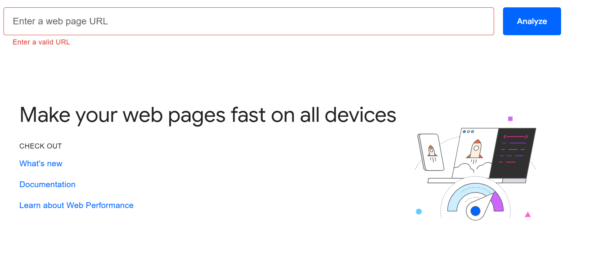

# GSC Studio

**GSC Studio** is a desktop application for Google Search Console data, built with **Tauri 2**, **React 19**, **TypeScript**, and **Rust**.

It surfaces Search Console performance, sitemaps, URL inspection, and technical SEO signals in a single, fast, native-feeling dashboard — plus an AI assistant for analyzing your organic search health.

---

## Table of Contents

- [Features](#features)
- [Screenshots](#screenshots)
- [How It Works](#how-it-works)
- [Tech Stack](#tech-stack)
- [Prerequisites](#prerequisites)
- [Getting Started](#getting-started)
- [Configuration](#configuration)
- [Usage Guide](#usage-guide)
- [Security](#security)
- [Project Structure](#project-structure)
- [Development](#development)
- [Building](#building)
- [Releases & Auto Update](#releases--auto-update)
- [Troubleshooting](#troubleshooting)
- [License](#license)

---

## Features

### Dashboard (Overview)

- Search Console–style interface for multiple properties.
- Key metrics cards: clicks, impressions, average CTR, average position.
- Performance trend chart with series for clicks vs. impressions.
- Data-driven performance recommendations.
- Query / page / country / device / search appearance / date breakdowns.
- CSV export of the current table.

### Performance

- Timeframes: **1 day, 7 days, 28 days, 90 days** (custom ranges supported downstream).
- Metric selection: clicks, impressions, CTR, average position.
- Interactive chart with hover tooltip (guide line, per-series dots, date + values).
- Smooth line draw / dot animations; reduced-motion friendly.
- "Last update: …" freshness label with live ticker.
- Stale-data handling: refetches keep previous data visible (dimmed) instead of flashing skeletons.

### Audits & Indexing

- **SEO audit** — combines Search Console performance data, sitemap health, and PageSpeed/Lighthouse technical reports.
- **Content audit** — content-performance comparison plus optional page inspection sampling.
- Both run with a real-time **progress bar** while running.
- Sitemap management: list, submit, delete, inspect.

### AI Assistant (Ask AI)

- Streaming chat assistant backed by **OpenRouter**.
- Context-aware answers grounded in the selected property's data.

### Navigation

- Collapsible sidebar groups (Overview, Audits, Indexing, Experience).
- Active-page highlighting, keyboard-friendly.

### Updates

- Single **Check for updates** button in the header.
- Checks the latest GitHub release and reports status:
  - `Update available: <version>` or `You are up to date`.

### Security

- Service-account credentials imported via file, validated against Google, encrypted with **Windows DPAPI**.
- OpenRouter API keys encrypted with **Windows DPAPI** (or `OPENROUTER_API_KEY` env var).

---

## Screenshots



---

## How It Works

1. The React frontend talks to a Rust backend via the Tauri IPC bridge.
2. The backend queries the Google Search Analytics API, the URL Inspection API, and PageSpeed/Lighthouse.
3. AI features stream responses from OpenRouter.
4. Responses are cached for one hour per cache key.

---

## Tech Stack

| Area | Technology |
| --- | --- |
| Shell | Tauri 2 (Rust) |
| Frontend | React 19, TypeScript, Vite |
| Backend | Rust (`tauri` crate, async commands) |
| HTTP | `reqwest` (Rust) |
| AI | OpenRouter (streaming) |
| Storage | OS app-data directory, DPAPI-encrypted credentials |
| Packaging | NSIS, MSI, portable executable |

---

## Prerequisites

- **Rust** (stable, edition 2024 toolchain)
- **Node.js** (22+ recommended)
- **pnpm**
- **Tauri system dependencies** (Linux: webkit2gtk; macOS: no extra; Windows: WebView2)
- A **Google service account** with Search Console access, **OR** Google OAuth credentials via the import flow.
- An **OpenRouter API key** (Ask AI).

---

## Getting Started

```bash
# 1. Install dependencies
pnpm install

# 2. Configure environment (optional but recommended)
cp .env.example .env   # or set OPENROUTER_API_KEY

# 3. Run in dev mode
pnpm tauri dev
```

The app opens at `http://localhost:1420` in dev mode and as a desktop window in production mode.

---

## Configuration

| Variable | Purpose |
| --- | --- |
| `OPENROUTER_API_KEY` | OpenRouter key for the Ask AI assistant (fallback when no key stored in-app). |
| Service account JSON | Imported through the app (Settings / Accounts). |
| GSC property | Selected via the property picker in the sidebar. |

---

## Usage Guide

1. **Import a service account** — launch the app, open the account picker, and import your Google service-account JSON.
2. **Select a property** — choose the Search Console property to analyze.
3. **Explore Performance** — switch timeframes, metric breakdowns, and open the chart hover tooltip.
4. **Run an audit** — open SEO audit / Content audit and press the run button; watch the progress bar.
5. **Ask AI** — open Ask AI and ask a question about your data.
6. **Inspect a URL** — use the header search bar to run URL inspections.
7. **Export** — export performance data to CSV.

---

## Security

Service-account credentials are imported through the app and never exposed to the frontend.

- Only the selected file path is passed from React to Rust.
- The file is validated and tested against Google before saving.
- Credentials are encrypted with Windows DPAPI, scoped to the current Windows user.
- The encrypted credential is stored in the Tauri application-data directory.
- Plaintext credential files are never stored by the app.

OpenRouter keys entered on the Ask AI page are also encrypted with Windows DPAPI. Alternatively, set `OPENROUTER_API_KEY` in the app's environment.

The legacy `.env.json` fallback is supported only for first-run migration and is excluded from version control.

---

## Project Structure

```
src/                  # React frontend (App.tsx, pages, components, styles)
src-tauri/           # Rust backend (commands, Google API clients, AI streaming)
src-tauri/capabilities/
.github/workflows/   # Release pipeline
```

---

## Development

```bash
pnpm dev            # Vite dev server
pnpm tauri dev      # Tauri dev (frontend + Rust backend)
pnpm tauri build    # Production build
```

---

## Building

```bash
pnpm tauri build
```

Windows installers are written to `src-tauri/target/release/bundle`.

---

## Releases & Auto Update

Pushing to `main` runs `.github/workflows/release.yml`, which:

1. Builds the React frontend and Rust backend
2. Produces the NSIS installer, MSI installer, and portable executable
3. Publishes them in a GitHub Release

The header includes a **Check for updates** button that queries the latest GitHub release and reports whether an update is available.

---

## Troubleshooting

- **No data / auth errors** — verify service-account credentials and property access.
- **Lighthouse / PageSpeed** — ensure Node.js and Chrome/Chromium are available for the technical audit environment.
- **AI errors** — configure `OPENROUTER_API_KEY` or store a key in the app.
- **Update check** — the check queries the GitHub latest-release endpoint; ensure the release exists and is published.

---

## License

This project is private. All rights reserved.
